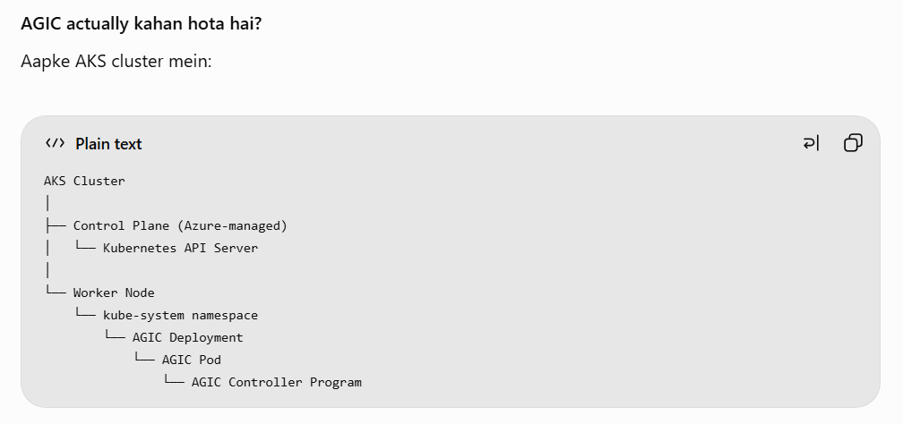

# AKS + AGIC | Learn With Satyam

Quick reference for exposing AKS applications through Azure Application Gateway Ingress Controller (AGIC).

## Architecture

`Browser → Azure DNS → Application Gateway → AKS Service → Pods`

AGIC runs inside AKS, watches Kubernetes Ingress resources, and configures Application Gateway listeners, routing rules, backend pools, and health probes. **AGIC manages configuration; it does not proxy application traffic itself.**



## Environment

| Resource | Value |
|---|---|
| AKS cluster | `aks-1` |
| AKS resource group | `satyam-rg` |
| Application Gateway | `ingress-appgateway` |
| Gateway resource group | `MC_satyam-rg_aks-1_australiaeast` |
| AGIC deployment | `ingress-appgw-deployment` |
| Ingress class | `azure-application-gateway` |
| Domain | `learnwithsatyam.in` |
| Public IP | `4.254.54.130` |

## 1. Connect to AKS

```bash
az login
az aks get-credentials -g satyam-rg -n aks-1
kubectl config current-context
kubectl get nodes -o wide
```

## 2. Verify AGIC

```bash
# Confirm the AGIC add-on is enabled
az aks show -g satyam-rg -n aks-1 \
  --query addonProfiles.ingressApplicationGateway -o json

# Controller status
kubectl get deployment ingress-appgw-deployment -n kube-system
kubectl get pods -n kube-system | grep ingress-appgw

# Recent controller logs
kubectl logs deployment/ingress-appgw-deployment \
  -n kube-system --since=10m
```

A running Pod alone does not prove that Application Gateway configuration was applied successfully. Review recent AGIC logs and Azure Activity Log.

## 3. Check application resources

```bash
kubectl get ingressclass
kubectl get ingress -A -o wide
kubectl get svc -n default -o wide
kubectl get pods -n default -o wide
kubectl get endpoints -n default
```

Every referenced backend Service must exist and have ready endpoints.

## 4. Example Ingress

Save as `ingress.yaml`. Confirm all referenced Services exist before applying.

```yaml
apiVersion: networking.k8s.io/v1
kind: Ingress
metadata:
  name: agic-paths-ingress
  annotations:
    appgw.ingress.kubernetes.io/backend-path-prefix: "/"
spec:
  ingressClassName: azure-application-gateway
  rules:
    - host: learnwithsatyam.in
      http:
        paths:
          - path: /azure
            pathType: Prefix
            backend:
              service:
                name: azure-service
                port:
                  number: 80
          - path: /aws
            pathType: Prefix
            backend:
              service:
                name: aws-service
                port:
                  number: 80
          - path: /gcp
            pathType: Prefix
            backend:
              service:
                name: gcp-service
                port:
                  number: 80
          - path: /
            pathType: Prefix
            backend:
              service:
                name: main-service
                port:
                  number: 80
```

Apply and inspect:

```bash
kubectl apply -f ingress.yaml
kubectl describe ingress agic-paths-ingress -n default
kubectl logs deployment/ingress-appgw-deployment -n kube-system --since=10m
```

**Path rewrite note:** `backend-path-prefix` is an AGIC-specific annotation. Test the actual path received by each backend; do not assume it behaves exactly like NGINX's `rewrite-target`.

## 5. DNS

In Azure DNS, the root `@` A record should point to the Application Gateway public IP.

| Setting | Value |
|---|---|
| Type | `A` |
| Name | `@` |
| Value | `4.254.54.130` |
| TTL | `3600` |

The registrar must delegate the domain to the Azure DNS nameservers assigned to your zone.

```bash
nslookup learnwithsatyam.in 8.8.8.8
```

Expected address: `4.254.54.130`.

## 6. Verify Application Gateway

```bash
# Gateway state
az network application-gateway show \
  -g MC_satyam-rg_aks-1_australiaeast \
  -n ingress-appgateway \
  --query "{provisioningState:provisioningState,operationalState:operationalState}" \
  -o json

# Backend health
az network application-gateway show-backend-health \
  -g MC_satyam-rg_aks-1_australiaeast \
  -n ingress-appgateway -o json
```

Check provisioning state and ensure relevant backend targets are healthy.

## 7. Test routes

```bash
curl -v http://learnwithsatyam.in/
curl -v http://learnwithsatyam.in/azure
curl -v http://learnwithsatyam.in/aws
curl -v http://learnwithsatyam.in/gcp
```

Validate application content as well as status codes. Investigate `404`, `502`, or timeouts using Ingress events, AGIC logs, Service endpoints, and backend health.

## 8. HTTPS

DNS and an Ingress `host` do **not** automatically enable HTTPS. Configure a valid certificate and HTTPS listener on Application Gateway before testing:

```bash
curl -Iv https://learnwithsatyam.in/
```

Enable HTTP-to-HTTPS redirect only after HTTPS is configured and tested.

## Quick troubleshooting

| Symptom | First checks |
|---|---|
| AGIC Pod restarts | `kubectl describe pod -n kube-system <pod>` and `kubectl logs -n kube-system <pod> --previous` |
| Service not found | `kubectl get svc -n default` |
| Empty endpoints | `kubectl get endpoints -n default`; verify selectors and Pod readiness |
| Ingress not reconciled | `kubectl describe ingress agic-paths-ingress` and AGIC logs |
| `502 Bad Gateway` | Backend health, probe path/port/protocol, network rules |
| DNS fails | Azure DNS A record, registrar nameserver delegation, public `nslookup` |
| HTTPS fails | Certificate hostname/validity, HTTPS listener, certificate binding |

## Key reminders

- Use `ingressClassName: azure-application-gateway`, not `nginx`, for this AGIC setup.
- Keep referenced Services and endpoints healthy.
- Check recent logs and backend health; a running controller alone is not proof of success.
- AGIC can manage Application Gateway configuration. Review existing gateway rules before enabling it on a gateway that serves other workloads.

## Official documentation

- [AGIC overview](https://learn.microsoft.com/azure/application-gateway/ingress-controller-overview)
- [Enable AGIC add-on](https://learn.microsoft.com/en-us/azure/application-gateway/tutorial-ingress-controller-add-on-existing)
- [AGIC troubleshooting](https://learn.microsoft.com/en-us/troubleshoot/azure/application-gateway/ingress-controller-troubleshoot)
- [AGIC annotations](https://learn.microsoft.com/en-us/azure/application-gateway/ingress-controller-annotations)

```sh

# AGIC Deployment
kubectl get deployment ingress-appgw-deployment -n kube-system

# AGIC Pod aur uska Worker Node
kubectl get pods -n kube-system -o wide | grep ingress-appgw

# Application Pods aur Worker Nodes
kubectl get pods -n default -o wide

# Ingress resource (Pod nahi hai)
kubectl get ingress -n default

# Worker Nodes
kubectl get nodes -o wide
```